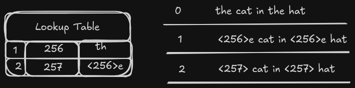

# Byte Pair Encoding Algorithm - Tokenizer

- This is an implmentation of the Byte Pair Encoding Algorithm used in tokenization of popular Large Language Models like GPT, Llama etc
- This is a simple version built from scratch, for educational purposes
- The BPE is a very important component out of the many components that makes an LLM possible, its is used to tokenize text for training the models, understanding prompts and generating reponses - of course, tokens is used as the metrics of the cost of running a model or pricing the api cost of using a cloud model.
- The BPE algorithm was originally created as a text compression method as described in 1994: "[A New Algorithm for Data Compression](https://github.com/tpn/pdfs/blob/master/A%20New%20Algorithm%20for%20Data%20Compression%20(1994).pdf)" by Philip Gage
- The original BPE tokenizer used for LLM tokenizer is a modified version of the original BPE idea, its the OpenAI implementation used in training the original GPT models can be found [here](https://github.com/openai/gpt-2/blob/master/src/encoder.py)
- The OpenAI's opensource [tiktoken library](https://github.com/openai/gpt-2/blob/master/src/encoder.py) is used by most LLM projects including Llama 3, due to its computational performance. Key parts of the library as been written in Rust making it fast, and memory efficient.

**This is a very simple implementation of the BPE algorithm for educational purpse**


### What is BPE?

- AI models are priced in cost per token
- A token is really the smallest possible piece of data or information that an LLM can prosess at a time
- It's also what the model predicts as in the reponse
- The BPE's job is to covert or represent text with an integer value called `token ID`
- The token ID is used for training LLM's

### Why is BPE?

- We know so damn well that a computer can not possibly understand human languages, such as English or symbols - so we need some sort of intemediate representation
- The best way to do that kind of representation is using numbers, precisely bits and bytes
- Without BPE we can choose to convert text for training into byte array and assign each individual character its own integer

```python
text = "This is some text"
byte_ary = bytearray(text, "utf-8")
# I would call list() on byte_ary to grab or extract the id of the individual character
ids = list(byte_ary)
print(ids)
```

```bash
[84, 104, 105, 115, 32, 105, 115, 32, 115, 111, 109, 101, 32, 116, 101, 120, 116]
```

- This can be a valid way to convert texts into the token ID representations needed for the embedding layer of an LLM
- The problem is that this method would produce its own ID for each character and that would be too long or too large, and might not provide meaningful relationship needed for the LLM to genrate or predict words that mimicks correct langauge
- As in the model will just be predicting characters instead of words (meaningful tokens)
- We need some sort of vocabulary where each token ID is for a whole words or subwords instead of a character
- If we use the GPT-2 tokenizer to tokenize the same text above ("This is some text") it only tokenie into 4 tokens instead of 17 tokens: `1212, 318, 617, 2420`


```python
import tiktoken

gpt2_tokenizer = tiktoken.get_encoding("gpt2")
tokens = gpt2_tokenizer.encode("This is some text")
print(tokens)
```

```bash
[1212, 318, 617, 2420]
```

- In this example, each words actually gets its own ID. This is much better, smaller and actually helps the LLM understand relationship between words better instead of just characters


### Need for Byte?
- A single byte can represent 2^8 = 256 possible values, ranging from 0 to 255
- A BPE tokenizer uses the 256 values to represent it's forst single-character tokens, thats usually the known standard characters -  ASCII
- The later learned multiple character tokens or subwords are represented usually using i_number_of_merges + 255.
- The original 1994 BPE algorithm only represent new characters or pairs using bytes that has not been used within the pool of the 0 - 255 values - limited!

### How BPE Tokenize?
- The original BPE algorithm was describe in 1994: "[A New Algorithm for Data Compression](https://github.com/tpn/pdfs/blob/master/A%20New%20Algorithm%20for%20Data%20Compression%20(1994).pdf)" by Philip Gage
- It works by repeatedly scaning text to find the most commonly occuring pairs of bytes or characters and merging them into a single new byte 
- It does this repeatedly until there is no new posible merges or maximum number of merges allowed has reached
- The final result is a set number of ID's representing some chracters compressed within it
- The original test can be restored by reversing the process of the compresson by substituting each ID with its coresponding pairs, using a lookup table

#### Tokenization Example


- At this point the token `257` represent the word `the` - awesome
- And thats kind of everything about BPE
- **Find the full BPE implementation at [main.py](main.py)**


### After Everything
- This is how BPE work, understanding this well enough, then can we build an embedding model to create a LLM
- This is a very simple implementation for educational purpose - try it.


#### Credits
- Rasbt - [BPE from Scratch](https://github.com/rasbt/LLMs-from-scratch/blob/main/ch02/05_bpe-from-scratch)
- Karpathy - [minBPE](https://github.com/karpathy/minbpe)